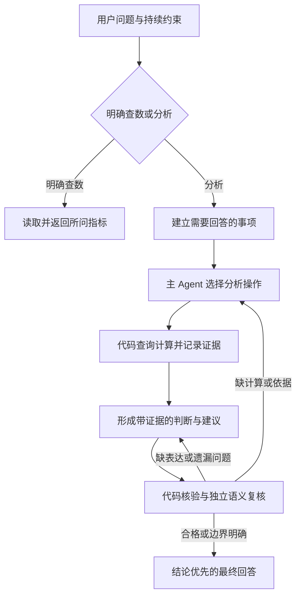

# 通用营销分析 Agent 设计

日期：2026-10-13。状态：架构方向已确认，本文待用户书面评审，尚未实施。

## 1. 目标与已确认约束

分析类回合交付对业务问题的判断、解释和行动建议，查询与计算结果负责支撑这些判断。明确查数继续直接回答所问指标，不强行附加营销建议。

用户已确认采用“主 Agent 持续分析、代码负责计算与证据、独立上下文复核回答”的架构方向，并明确本次先不设置耗时和模型调用成本的硬上限。没有成本上限不意味着重复查询可以算作进展；结束由问题是否得到回答、证据与能力边界是否明确决定。

通用性的范围是现有周大福授权数据上的查数、诊断、比较、机会发现和策略建议。在已有字段与分析能力范围内，更换活动、门店、时间范围或问题问法，应新增零条 case 分支、零条业务名称白名单。需要新数据或新统计方法时，扩展数据适配器、指标定义或分析操作，不为某句用户问题增加特殊流程。

继续保留连续对话、只读数据、私有证据、浏览器访问标识与同源检查、可取消回合，以及 Campaign/1811 执行隔离。历史建议、普通点头和分析候选不自动成为执行事实，不创建或提交外部活动。

本设计不新增客户数据导入流程或客户技术表单，不接入库存、CRM、投放等未连接系统，不改客户表、视图、索引或账户，不建立跨行业分析平台。

## 2. 当前缺口与架构选择

当前 `agent/analytics-run-turn.ts` 以 Skill 加载、工具读取和合法结构化结果作为主要结束条件；`agent/analytics-tools.ts` 在数据库模式的 `discover_segments` 只提供预设分析方向。数据库接口主要返回按维度汇总的前列结果，不能自动提供可比对照、变化拆解和稳健性检查。

现有 `AdvisorSource` 的范围与指标含义主要存为展示文字。来源编号存在，不代表几份来源可以直接比较；数值真实，也不代表解释或策略有依据。现有数字守卫与部分恢复还会把分析分成大段数据展示和简短定性条目，局部过滤后缺少重新完成判断的流程。

三个方向的取舍：

- 仅强化 Skill：可改善思路，但无法提供缺少的计算能力，也无法确保最后回答完整。
- 仅增加结果审阅：可发现遗漏，但缺少可执行的纠正方法与任务状态，容易反复审阅同一份不充分的结果。
- 统一分析任务、分析操作、证据与回答复核：让纠正能够实际执行，并在不同业务问题之间复用。采用此方向，Skill 和独立审阅作为其中的组成部分。

## 3. 职责与整体流程

主分析 Agent 负责理解原问题、形成待验证判断、选择方法、解释业务含义和提出行动建议。计算层负责授权范围、查询、计算、可比性检查、实际检查记录与证据生成。独立审阅模型负责对照原始问题检查语义、依据和建议。编排器维护任务状态、校验引用、执行纠正循环和处理取消。



这些是逻辑职责，不固定为多个长期运行的服务。复用现有 Node Agent 服务和 SDK；独立审阅使用单独的模型上下文，不共享主分析模型的隐藏思维。页面与 Workers 继续承担访问隔离和消息呈现。

## 4. 分析任务合同

每轮建立 `AnalysisTask`，由服务生成 `runId`，包含以下内容：

- 原始用户问题、当前轮用户原话及持续约束；最新明确纠正优先。
- 数据访问授权与业务筛选范围，二者分别保存。模型不能扩大访问授权，也不能自行解除用户明确保留的筛选。
- 需要回答的事项：每项有服务分配的 id、关联用户原话、期望回答的判断、所需证据与当前状态。
- 业务目标与重要假设；用户没有给出的偏好不得写成用户事实。
- 已执行操作、可用证据、候选判断、审阅缺口和下一步。

区分焦点对象与硬范围限制。例如“看这家店相比同区域其他店如何”允许在授权范围内取得参照组；“只使用这家店的数据”则不能读其他店作为对照。区分依据来自原问题及持续约束，并接受独立任务审阅，不能由模型以方便计算为由解除硬限制。

需要回答的事项从问题动态形成，不按活动名称、某个门店或具体句式预置。查数、诊断、比较等任务类别只帮助选择方法，不规定统一的查询次数、假设数量或答案段落数。

任务草案也接受独立审阅。审阅必须读取原始问题和持续约束，能够指出主 Agent 漏掉或理解错误的事项；不能只检查主 Agent 自己声明的任务是否完成。修订事项时保留原话关联和修订记录。

事项状态为 `open`、`supported`、`conditional`、`needs_business_input`。其中 `supported` 表示相关判断有实际证据支持，不表示已经证明因果；证据级别在判断合同中另行表达。

只有工具无法取得、需要客户确认且会改变建议的业务事实，才进入业务追问。数据可以继续计算、分组可以继续比较时，应由 Agent 继续完成。

用户未定义“好”“有效”等判断标准时，Agent 可以提出与问题相关、当前可计算的比较标准，并在答案中说明采用的标准与局限。它是分析假设，不是用户已经确认的目标；不同目标会实质改变建议且不能从上下文推导时，先给有条件判断，再询问必要的业务目标。

## 5. 数据能力与分析操作

### 5.1 统一接口与数据适配器

导入快照、实时 MySQL 和受控历史案例使用统一的业务能力描述，声明可用字段、对象、指标、粒度、周期、口径和支持的分析操作。可用能力由适配器根据实际数据生成，不能因为工具名称存在就标为支持。

历史案例只有聚合结果时，可支持阅读和有条件参考；缺少原始粒度时，不支持凭空重建订单、去除大单或计算新的跨期结果。

模型只提交受支持的业务参数、对象引用和分析操作，不提交 SQL、连接信息、任意表名、任意文件路径或可执行代码。字段映射、查询编译、确定性计算与结果保存留在 TypeScript/Node 适配器。

### 5.2 本次需要交付的通用操作

`AnalysisOperation` 是有辨别用途的业务操作，输入必须关联当前待回答事项。每项输出结构化结果、实际方法、范围、指标、缺失与限制，以及可引用的事实和对象。

1. **汇总**：读取明确范围内的金额、数量、订单等指标，保留真实总体与分组规模。
2. **可比对照**：明确目标组、参照组、共同门店或其他控制条件，计算差额、比率及适用范围。支持同一期不同群体及同一群体不同窗口。
3. **变化拆解**：按指标定义拆数量、价格、结构或销售/退货贡献。分母无效、粒度不足或方法不适用时返回不可计算原因，不能套用公式补零。
4. **分组偏离**：比较下层分组相对父组或参照组的表现，返回偏离方向、规模、贡献和样本信息。候选来自实际分析范围，不从销售额前列列表冒充全范围扫描。
5. **分布与稳健性**：检查订单成交部分分布、共同门店、去除最大门店或大单，以及替代日期窗口。检查是否适用由数据能力决定；未执行的检查必须明确标识。

以上操作可组合，不要求每轮全部执行。新增问题在同一能力范围内复用操作；新增方法需要独立定义输入、计算、适用条件与验证。

### 5.3 方法与指标定义

每个 `MetricDefinition` 明确语义、单位、销售/净销售/回收等人口口径、粒度、可加总性、允许的派生计算和可比条件。金额按行换算为分后汇总，缺失值不填零；订单按门店与销售单号组合，当前筛选内的订单成交部分不能冒充完整订单。

比率从其分子、分母生成，不能对不同规模分组简单平均。比较毛利、价差和每克金额时必须使用对应指标的业务定义；展示标签相同不足以认定口径相同。每克代理指标的跨材料、跨货类比较不能被用于证明优惠更有效。

财务口径尚未与业务对数时，证据保留探索状态。技术计算核验不能把口径升级为业务已确认，也不能使历史差异自动成为活动增量。

`MethodReport` 记录实际执行的控制条件、参与和未参与样本、排除规则、分母处理及检查结论。去除最大门店时必须区分全局最大与组内最大，并记录按哪个指标选取；大单检查必须区分完整订单与筛选内成交部分。

操作结果可分页选择候选，但保留总体规模、排序依据及未展示部分的含义。结果页大小是传输策略，不是分析是否完成或是否找到机会的依据。

### 5.4 参数边界

所有方法使用授权数据框及其能力目录中的指标、维度和对象引用。派生数据框可选择覆盖范围内的日期和对象子集，不能改变用户硬限制或引入未知字段。五种方法的参数分别限定为：

- 汇总：分组维度及指标引用；分组维度可组合的能力由适配器声明。
- 对照：目标与参照数据框、共同对象规则、控制维度及适用的时间对齐规则。目标与参照的差别必须显式记录。
- 拆解：目标与参照数据框、被拆解指标及登记的拆解方法 id；模型不提交计算表达式。
- 扫描：父层、拆分维度、参照规则、控制维度及登记的样本/排序规则 id。样本规则是方法适用性限制，不是用户事实或因果证明。
- 稳健性：被核对的操作/判断引用、检查类型及参数；最大门店、大单与替代窗口必须引用实际可读取的对象、粒度和周期。

样本、排序和对齐规则来自版本化方法目录；模型选择规则，不能凭空填写阈值、伪造新规则或把不支持的操作标为执行成功。

## 6. 结构化证据与数据版本

新增统一证据图，由代码建立和维护：

- `DataFrame`：数据模式、授权数据句柄、快照身份、周期、结构化筛选、对象集合、币种、人口口径、粒度及限制。
- `Fact`：事实 id、指标定义 id、真实值或明确缺失、单位、所在数据框及生成操作。
- `ObjectReference`：实际读取的活动、门店、货类等对象及其业务名称；编号与名称由代码解析。
- `DerivedFact`：派生事实及父事实、方法与计算记录；差额、比率和拆解贡献只能由代码生成。
- `MethodReport`：实际执行的比较和检查，不能由模型填写“已检查”代替执行。

身份、数值、单位、范围和检查结果不能由模型覆盖。模型引用事实或对象 id，服务从本轮授权证据中解析；未知引用返回待修正问题。

### 6.1 快照一致性

导入数据沿用不可变数据版本。实时 MySQL 分析运行使用显式只读、可重复读的一致性事务，把同一运行中的分析操作绑定到同一快照身份；同一连接上的执行由适配器排队，不将并发 SDK 工具调用解释为并发写入。

单次数据库资源截止继续保留。取消、连接失效或数据库截止导致快照结束时，不得把新连接的结果静默混入旧快照。继续分析需创建新快照，并重算最终判断依赖的数据库事实；已保存的旧证据继续保持不可变，标明历史快照。

历史参考和不同授权导入版本可以作为明确区分的参考。跨数据版本的数值比较必须是显式操作，检查定义、粒度、币种和对照条件，不能由模型拼接后当作同口径结果。

证据快照身份与每条记录的内容摘要分别保存。内容摘要不能因含查询时间就被当成“数据有了变化”的证明。

### 6.2 去重与进展

同一运行、同一快照、同一规范化业务操作复用已经捕获的结果。缓存键包含方法版本、结构化范围、指标、控制条件及比较对象；不能只按用户文本去重。

用户换范围、明确要求重新核对、数据快照变化或方法参数变化时重新执行。每个新操作关联它要检验的事项或审阅缺口。

进展来自新的有效事实、实际完成的检查、被证据支持或否定的判断，以及被消除的任务缺口。新记录编号、新时间戳、重复表格和重复表述不算新增证据。

## 7. 判断、建议与正文合同

新回答使用 `analysis-answer/v2`，包含任务、整体回答状态、需要回答事项的覆盖关系、判断、正文、所用证据、实际过程及业务追问。

`Conclusion` 至少包含：关联事项 id、判断文本、依据引用、证据级别、重要限制、适用对象，以及有意义时的建议与验证办法。事实观察、可比差异、可能的解释和行动建议分别表达，不将假设写成已经验证的原因。

证据级别为 `observed`、`comparison_supported`、`hypothesis`。本次没有因果实验或可信因果估计能力，不提供 `causal_proven` 或未来收益保证。新颖性只能表达为候选及依据，客户是否已知仍需业务评估。

### 7.1 连贯表达与引用

正文使用结构化段落和行内节点。节点包括定性文本、事实引用、对象引用、周期引用，以及经原话核对的用户条件引用。模型负责组织句子，代码负责解析真实值、单位、合理精度和出处。

同一个事实可放在结论句或解释句中，不强制先生成一个大表再写定性说明。活动名、门店编号和日期通过对应引用显示，不需要逐个添加数字名称豁免。

自由文本不承载未绑定来源的经营数量。用户给出的假设保留用户原话与假设身份；它不升级为测量结果。试点方案的数量或期限只能通过明确标为“建议设置”的计划节点表达，并与实际观察、收益预测及已确认执行参数隔离。未经证据支持的增长预测不接受这种节点包装。

本次计划节点仅支持试点对象数量及试点天数：对象数量由所选真实候选引用计算；天数为明确标为拟议的正整数，并表达尚需确认的业务条件。折扣、克减、预算和收益比例不开放给模型通过这个节点自由填写；活动名称中的数字也不能被解析成已确认的规则参数。

不能确定的值保持缺失或未知，不补零、不从类别名称推算规则参数。无效节点应反馈给主 Agent 修正，不直接删除结论的一部分后宣称分析完成。

### 7.2 回答状态

- `answered`：主要事项有对应判断，硬核验与独立复核通过，重要限制已表达。
- `conditional`：给出了与问题相关的有条件判断；关键缺口来自已确认的数据能力或未提供的业务事实，已说明如何改变判断及如何验证。
- `incomplete`：仍有必要且可以继续完成的分析未做，或上游运行/复核未完成。可保留明确标识的已核验事实，但不能作为完成的分析显示。

缺口可通过现有操作补齐时，编排器继续分析，不允许靠写“待验证”跳过。能力不足时，尽可能给出有条件的行动方向；有条件建议不能伪装成已经验证的有效策略。

### 7.3 核心接口草案

以下字段是模块之间的合同草案；具体方法参数由对应操作的严格 schema 定义，不提供通用任意表达式。所有注册 id、值、范围与检查状态均由代码生成或校验。

```ts
type AnalysisNeed = {
  id: string;
  userQuote: string;
  judgement: string;
  status: "open" | "supported" | "conditional" | "needs_business_input";
  conclusionIds: string[];
};

type OperationRequest = {
  needIds: string[];
  purpose: string;
  method: "aggregate" | "compare" | "decompose" | "scan" | "robustness";
  frameIds: string[];
  metricIds: string[];
  // 由 method 对应的严格参数类型限制，不能包含 SQL 或任意字段名。
  parameters: MethodParameters;
};

type OperationResult = {
  operationId: string;
  status: "completed" | "unsupported";
  frameIds: string[];
  factIds: string[];
  methodReportId: string;
  limitations: string[];
};

type AnswerNode =
  | { kind: "text"; text: string }
  | { kind: "fact_ref"; factId: string }
  | { kind: "object_ref"; objectId: string }
  | { kind: "period_ref"; frameId: string }
  | { kind: "user_condition_ref"; conditionId: string }
  | { kind: "trial_parameter_ref"; parameterId: string };

type ReviewIssue = {
  needIds: string[];
  conclusionIds: string[];
  requirement: string;
  kind: "task_coverage" | "missing_evidence" | "invalid_comparison"
    | "unsupported_explanation" | "unclear_action" | "expression";
};

type SemanticReview = {
  verdict: "accept" | "revise" | "accept_conditional";
  issues: ReviewIssue[];
};
```

本设计中的 `MethodParameters` 表示五种已定义方法的判别联合，不是开放字典；实现计划必须为每种操作列出可传入的字段、参照规则和检查参数。运行错误通过实际错误与取消通道返回，不与 `unsupported` 混为一类。

## 8. 两层核验与纠正循环

### 8.1 代码核验

代码核对访问与业务范围、事实和对象是否实际读取、数值与派生链路是否真实、单位与粒度是否可比、实际方法是否执行、引用版本是否正确，以及任务与正文的结构关系。

它返回具体问题：对应事项、结论或节点、失败类型、可用引用或缺少的操作。代码不能声称已经判断自然语言分析是否足够深入。

### 8.2 独立语义复核

审阅模型获得原始问题、持续约束、任务草案、结论草稿、所用事实，以及本轮执行操作和结果的目录。它可通过只读工具检查本轮已捕获证据；不能自行查询数据库、读任意文件或创建活动。

审阅同时检查任务理解和最终回答，重点包括：

1. 原问题的重要判断有没有遗漏、是否偷换成查数或排名。
2. 基准和指标是否回答了问题，比较对象与控制条件是否合理。
3. 证据是否支持具体关系，是否把品类结构、规模或选择偏差当成效果。
4. 重要替代解释有没有被处理，未执行的检查有没有被诚实说明。
5. 建议是否从分析推出，适用对象、条件、取舍和验证方法是否清楚。
6. 明确查数是否被附加不必要的营销分析或追问。

复核输出 `accept`、`revise` 或 `accept_conditional`，以及与原问题相关的必要缺口；一般优化意见不成为无限追加的硬要求。审阅不能改写事实、解除授权或投票推翻确定性计算。

### 8.3 纠正与停止

缺少证据时回到分析操作，缺少解释或正文时修正草稿，任务理解错误时修订需要回答的事项。主 Agent 可以说明审阅意见不适用的理由，但必须引用原问题、实际方法或证据，并接受再次独立复核。

代码核验和语义复核通过后才生成最终分析结果。固定查询次数、字数、表格数量和通用“质量分数”都不是通过条件。

本次不加应用层墙钟或总模型成本截止。SDK 的逻辑回合窗口不等同于任务总预算：窗口用尽且存在明确的新分析步骤时，编排器可开启后续窗口，携带显式任务与证据摘要；新窗口重新执行所需 Skill 门禁，不携带或保存隐藏思维。

若同一必要缺口反复出现、同一操作结果与草稿没有有效变化，编排器先要求改用实际可用的方法或说明能力缺口。仍不能产生新信息时结束为 `conditional` 或 `incomplete`，保留真实判断与具体限制，不重跑同一查询来增加步骤数量。

供应商、鉴权和数据库实际失败继续按真实运行错误处理，不改写成“业务证据不足”。用户取消应立即传递给主 Agent、审阅、查询和后续 SDK 窗口；取消后的迟到结果不进入页面或证据图。

## 9. Skill、上下文与分析/执行边界

寒暄、致谢、能力介绍和明确无业务筛选上下文的月份总额继续走代码快速路径。需要模型解释条件的查数加载 `analytics:analysis-review`；分析、复盘、比较机制和策略建议加载两份分析 Skill。

Skill 提供业务理解、方法选择、解释和写作原则。计算、字段映射、指标定义、可比性校验、授权和任务状态仍在 TypeScript。营销顾问继续遵守已有五章格式约定，执行插件的出处校验不改变。

主分析和审阅使用独立会话策略及工具集合。审阅只能读取已经授权的证据与规则，不因“审阅需要”取得数据库查询、文件、网络或活动写入权限。`settingSources: []` 与个人配置隔离继续保留。

持续要求和用户最新纠正参与每轮任务理解；业务限制有原话依据。分析候选和建议不自动拼入 Campaign 创建输入，执行仍经原有受控入口与事实守卫处理。

## 10. 页面、协议与兼容

继续复用现有对话布局、输入框、时间、复制、停止、消息与过程卡片。正文先回答核心判断，再说明关键数据、解释、行动与条件；详细结果、计算方法、范围和限制通过出处展开。

过程展示只由实际行为生成，例如执行对照、检查分布、复核回答及修正判断。只发送公开步骤、真实状态、摘要和实际耗时；不展示隐藏思维、系统提示词、SQL、完整工具参数或内部堆栈。完成后的正文仍可选择与复制。

通过 `X-Analytics-Answer-Schema: analysis-answer/v2` 协商新回答合同，沿用现有分析请求、访问标识、同源检查和 Agent 服务鉴权。新客户端使用 v2；未声明新合同的调用保留 v1 路径，不向旧解析器发送无法识别的新结构。

已有 v1 回答与浏览器会话继续读取，不把旧证据文字补装成新口径、不重写原报告或历史消息。新回答保留当前浏览器会话恢复能力。分析运行和证据恢复不升级为跨浏览器共享客户历史。

v2 响应只携带最终使用的事实、对象、必要派生关系和出处，不把整个搜索空间塞入正文或模型上下文。传输大小与分页是实现约束，不能作为业务结论已经成立的理由。

## 11. 私有记录与模块归属

扩展现有私有证据目录，保存每个运行的业务问题、任务版本、操作与证据引用、公开业务草稿、核验缺口、修订和最终结果。记录草稿是为了复盘具体丢失或修正的判断，不保存模型隐藏思维、系统提示词或连接凭据。

业务草稿指准备向客户表达的结构化内容，仍可能尚未通过核验。它只进入经过敏感信息处理的私有审阅记录，不以正文增量提前发给客户。

原始客户数据、SQL 捕获、真实经营数字和运行记录继续在仓库与默认镜像之外。页面的引用解析使用本轮已经校验的公开业务证据，不开放任意磁盘路径。目录与文件名由服务生成，模型只使用业务引用 id。

建议模块归属：

- `app/lib/analytics/`：任务、指标、操作、证据与回答合同，以及不依赖运行平台的确定性核验与解析。
- `agent/analytics-tools.ts` 及拆出的分析操作层：能力路由、参数校验、只读适配和本轮证据注册。
- `agent/analytics-run-turn.ts` 及拆出的编排/审阅模块：主分析、独立复核、纠正、SDK 窗口与取消。
- `app/lib/server/analytics-*.ts` 与分析 API：访问隔离、合同协商和 NDJSON 转发。
- `app/components/analytics/`：v2 正文、来源与实际过程展示，以及 v1 兼容读取。

共享模块继续满足 Node strip-types 边界：相对引用使用 `.ts`，不引入 Workers 绑定、数据库包或其他 npm 包。MySQL、SDK 和私有文件操作留在 Node 层。本设计不要求重建、清空或迁移已有 D1 活动数据。

## 12. 通用验收

### 12.1 确定性与运行验收

使用构造数据与脚本化模型验证真实计算和编排，包含：金额按分、零与缺失、共同门店、粒度和币种、派生关系、实际排除检查、引用不可伪造、重复操作复用、纠正后再提交、快照失效重算、取消、版本协商与旧会话恢复。

必须验证“数据全部正确但核心问题未回答”不能通过语义复核；“审阅缺口可以计算”必须继续执行；“未执行检查”不能显示为通过；“只保留事实”不能冒充已经完成的策略分析。

### 12.2 跨问题业务验收集

验收使用明确标为模拟的合成快照与仓库外的受授权真实证据，按问题族固定人工判断标准，至少包含以下情况：

1. 明确总额与受筛选查数：范围和口径正确，得到所问指标，没有额外营销建议。
2. 变化诊断：数据分别构造数量、价格、结构与退货因素，回答能定位实际主要贡献，并区分算术贡献与未验证的业务原因。
3. 整体与局部分化：在可比条件下识别真实偏离分组；不能凭销售额前列、门店规模或类别高价称为机会。
4. 活动策略比较：目标和参照明确，控制参与门店及品类差异；有条件的历史支持不升级为最优力度或未来收益。
5. 大店与大单假象：执行相应检查后，发现消失时收回原建议或降低判断级别。
6. 单窗口数据：使用可用的同期对照，不能因没有跨年数据直接结束；也不能编造跨期变化或活动增量。
7. 能力缺失：会员销售标识不能推复购或新老会员；缺库存、成本或真实规则时缩小受影响判断，同时保留其他有依据的建议。
8. 对话与问法变化：更换业务名称、同义问法和持续筛选，逻辑结论与边界保持一致，业务代码不增加 case 条件。

不要求每个问题都产生“新发现”，也不规定至少几个候选。确实没有稳健候选时应说明实际检验结果，并给出合理的后续验证或行动方向。

### 12.3 真实模型质量验证

真实模型在上述问题族上回答，再与人工事先确定的事实、判断要点和不可支持结论核对。审阅模型的“接受”不是业务质量验收的唯一依据。

检查问题覆盖、数据与比较依据、解释边界、建议具体性、元数据忠实性和条件表达。记录模型/Skill/方法版本、运行产物、修订次数、实际耗时和调用数；这些是可复盘信息，不把查询更多或回答更长当作分析更深。

默认自动测试继续不调用付费模型。真实评估作为显式执行的独立验证环节，客户认可业务新颖性仍单独确认。

## 13. 落地边界与交付条件

实现计划以本设计的任务、证据、方法和回答合同为共同边界，可按合同基础、分析操作、编排复核、页面兼容和业务评估安排工作。每一阶段都运行适用的回归，不仅交付一个只能生成任务清单的框架。

本次通用版本的启用条件包括：实际可用的上述分析操作、可追溯判断、独立复核与纠正、连贯正文、完整取消与 v1 兼容，以及跨问题业务验收。未完成的操作在能力描述中标为不支持，不能以空洞察或预设方向冒充已完成分析。

现有名称豁免、字符串范围解析和删条目后返回的容错，由 v2 的结构化引用、范围与纠正合同逐步接管。v1 兼容读取保留旧合同，不继续把新规则追加到旧恢复逻辑。

## 14. 自审与评审状态

本文已明确架构职责、数据能力、实际方法、快照一致性、数字引用、回答状态、独立复核、纠正与停止、权限、兼容和业务验收。方案不依赖某个真实活动或门店名称，不包含客户真实数值、连接信息和内部执行代码表。

需用户评审的是本设计整体及其接口与行为边界。本文通过书面评审后，下一步生成实现计划，并在计划评审与执行方式确定后开始修改业务代码。

## 15. 依据

- 本轮用户明确要求通用性调整，避免按 case 打补丁；已确认整体架构方向，暂不设置耗时与模型调用成本硬上限。
- 仓库 `AGENTS.md`：数据口径、只读查询、浏览器访问隔离、Skill、取消、私有证据、共享模块与活动执行边界。
- `docs/superpowers/specs/2026-10-13-marketing-advisor-integration-design.md`：既有分析与连续对话合同。v2 专项行为实施后由本文定义；未涉及的原有行为继续沿用原合同。
- `agent/analytics-run-turn.ts`、`agent/analytics-tools.ts`、`app/lib/analytics/{database,engine,advisor,explain,types}.ts`：当前运行时及其具体缺口。
- `app/components/analytics/advisor-answer.tsx`、`app/lib/client/{history-conversation,history-stream}.ts`：现有回答与会话呈现。
